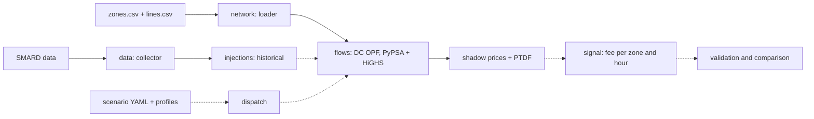

# gridfee-signal

Open-source congestion-based grid fee signals for battery storage in Germany.

Germany is redesigning grid fees for battery storage (BNetzA's AgNeS process). Today a
battery pays the same fee whether it relieves or worsens grid congestion. This tool
computes an hourly congestion signal per zone from a DC optimal power flow on a zonal
network of Germany and turns it into a fee signal with a relief credit for storage that
charges during congestion. It is meant for historical backcasts and for forward-looking
scenarios driven by user-supplied inputs.

**Status: milestone 2 of 6.** The network loader, the DC OPF runner, the SMARD collector
and historical injections are in place. The fee signal, validation and scenarios are not
built yet, and the repository ships the 22 zones of Germany but not yet the lines between
them (see [Roadmap](#roadmap)).

## Quick start

Python 3.11 or newer.

```bash
pip install -e ".[dev]"
pytest

gridfee run \
  --network examples/networks/three_zone \
  --load examples/inputs/three_zone/load.csv \
  --generators examples/inputs/three_zone/generators.csv \
  --out results/three_zone
```

This solves three hours on a synthetic three-zone network and writes `flows_mw.csv`,
`shadow_prices.csv`, `nodal_prices.csv`, `dispatch_mw.csv` and `ptdf.csv`. Add
`--hours hours.csv` to solve only a subset of hours (for example representative hours).

The same from Python:

```python
import pandas as pd
from gridfee.network import load_network
from gridfee.flows import run_dc_opf

network = load_network("examples/networks/three_zone")
load = pd.read_csv("examples/inputs/three_zone/load.csv", index_col=0)
generators = pd.read_csv("examples/inputs/three_zone/generators.csv", index_col=0)

result = run_dc_opf(network, load, generators)
result.shadow_prices  # hours x lines
result.ptdf  # lines x zones
```

## Architecture



Solid arrows exist today; dashed ones are planned.

## Historical data and injections

```bash
gridfee collect --year 2023 --reference data/reference/annual_totals.csv
gridfee injections --zones data/networks/de22/zones.csv --year 2023
```

`collect` downloads hourly load, onshore wind, offshore wind and solar per TSO zone,
national load and generation by fuel, and physical cross-border flows per TSO zone and
neighbour, from [SMARD](https://www.smard.de) (public, no key)
into `data/raw/`. Downloads are cached in `data/cache/smard/`. Hours are Europe/Berlin.
Runs of up to 3 missing hours are interpolated and logged; longer gaps stop the run
(in cross-border series they stay missing and are reported).
With `--reference`, annual totals are compared with Bundesnetzagentur figures (±5 %).

`injections` splits each TSO zone's series over its zones: demand by population share,
wind and solar by capacity share (`--population-shares`, `--capacity-shares`). It writes
hourly demand, feed-in and net injection per zone, the shares used and an energy-balance
report per TSO zone.

Read [docs/DATA.md](docs/DATA.md) before using the output. In short:

- **Shares are placeholders.** No share files ship yet, so every zone of a TSO zone gets
  the same share. The output flags this (`shares.csv`, column `placeholder`, and a
  warning). Placeholder results do not show where power is produced or used.
- **The 22 zones have no lines yet**, so they cannot be run through the OPF.
- **Four zones' TSO differs from the drafts** and several zones are split between two
  TSOs; see [TSO_SOURCES.md](data/networks/de22/TSO_SOURCES.md).
- **Cross-border flows are collected but not used yet**: boundary zones get them once
  the 22-zone network has lines.

## Network config

A network is a directory with two CSV files. Lines starting with `#` are comments.
See [docs/NETWORK.md](docs/NETWORK.md) for all rules and for deriving a zone network
from PyPSA-Eur.

`zones.csv`

| column | meaning |
| --- | --- |
| `zone_id` | unique id |
| `name` | display name |
| `kind` | `internal` (zone in Germany, default) or `boundary` (neighbouring country) |
| `tso_zone` | `50Hertz`, `Amprion`, `TenneT` or `TransnetBW`; required for internal zones, empty for boundary zones |
| `country` | country code; required for boundary zones |
| `lat`, `lon` | optional coordinates |

`lines.csv`

| column | meaning |
| --- | --- |
| `line_id` | unique id |
| `from_zone`, `to_zone` | the two zones; flows count positive from `from_zone` to `to_zone` |
| `susceptance_mw_per_rad` | MW of flow per radian of voltage angle difference |
| `capacity_mw` | flow limit in both directions |

## Sign conventions

- **Flow**: positive from `from_zone` to `to_zone`.
- **PTDF** (line l, zone n): change of the flow on l when 1 MW more is injected at n and
  withdrawn at the reference zone (default: the first zone; a distributed reference is
  supported).
- **Shadow price** of a line, in EUR/MWh per MW: the cost saved by one more MW of
  capacity. Positive when the line is congested from `from_zone` to `to_zone`, negative
  when congested the other way, 0 when not congested.
- **Nodal price**: `price[n] - price[m] = -sum over lines l of (PTDF[l,n] - PTDF[l,m]) * shadow_price[l]`.

The sign convention of the fee signal itself is set in milestone 3.

## Limitations

- Zone-level precision only; nothing can be said about individual substations or lines.
- DC (linear) approximation: no losses, no reactive power, no voltage limits.
- The hours of an OPF run are independent of each other.

`METHODOLOGY.md`, `SCENARIOS.md` and `LIMITATIONS.md` follow with the modules they describe.

## Roadmap

| milestone | content | state |
| --- | --- | --- |
| M1 | scaffold, network loader, DC OPF runner, synthetic-network tests, CI | done |
| M2 | SMARD collector, historical injections, energy-balance checks | done |
| M3 | fee signal and validation; 2023 backcast end to end | planned |
| M4 | scenario schema, profile import, dispatch, scenario runner | planned |
| M5 | sensitivity runs, scenario comparison, CLI polish, docs | planned |
| M6 | BESS impact module, dashboard (stretch) | planned |

## Licence

MIT, see [LICENSE](LICENSE).
